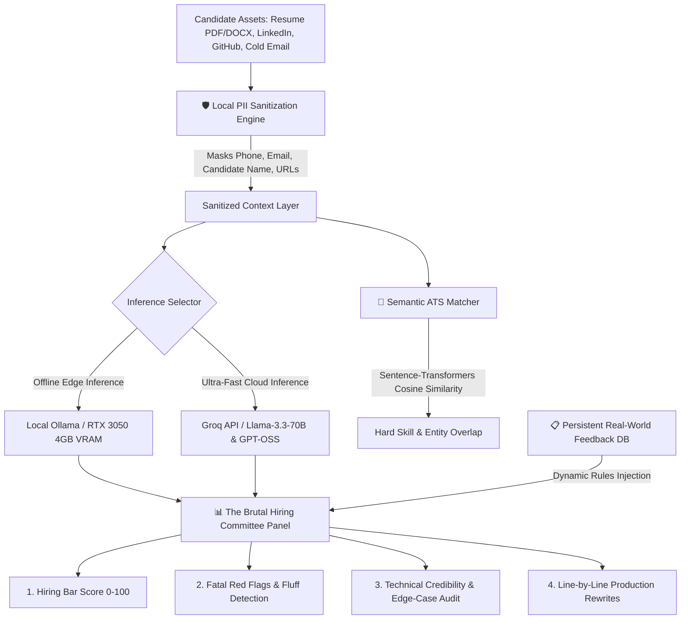

# ⚡ HirePulse AI: Autonomous Technical Career & Hiring Intelligence Engine

[](https://www.python.org/)
[](https://streamlit.io/)
[](https://www.nvidia.com/)
[](https://opensource.org/licenses/MIT)

> **HirePulse AI** is an offline-first, privacy-preserving career intelligence platform built for technical candidates and AI engineers. It combines local LLM reasoning, dynamic PII sanitization, semantic ATS matching, and automated brutal peer-review by simulating a joint panel of a **Principal AI Architect** and a **Senior Technical Recruiter**.

---

## 🏗️ System Architecture



---

## ✨ Key Capabilities

### 1. 🛡️ Client-Side PII (Personal Identifiable Information) Masking
* **Zero Leakage**: Automatically regex-masks phone numbers (`[PHONE_REDACTED]`), email addresses (`[EMAIL_REDACTED]`), candidate identity (`[CANDIDATE_NAME]`), and social URLs before transmission to cloud APIs or external models.
* **Full Transparency**: Real-time audit badge reveals exact redaction metrics before network transmission.

### 2. 🔥 The Brutal Hiring Bar Audit
* Simulates an unfiltered evaluation panel composed of a **No-BS Technical Recruiter** and a **Principal AI Architect**.
* Eliminates passive voice, detects tutorial clones (MNIST, Iris), checks for quantifiable Google XYZ metrics, and flags hardware/latency omissions.

### 3. 🧠 Technical Interview Drill Lab ("My Knowledge")
* Practice architectural interview questions tailored to speech AI, local quantization, CUDA VRAM budgeting, FastAPI concurrency, and MongoDB indexing.
* Evaluates answers on a 1–10 scale against real Staff Engineer interview bars and provides model solutions.

### 4. 🎯 Semantic ATS Scorer & 75-Word Pitch Generator
* Extracts text from `.pdf` and `.docx` resumes.
* Compares candidate skills against job postings from Hasjob, Wellfound, and LinkedIn to generate hyper-targeted, 75-word technical cold emails.

### 5. 📋 Dynamic HR & Architect Knowledge Manager
* An extensible, JSON-backed knowledge store (`rubric_knowledge.json`) where candidates can log actual rejection reasons and hiring feedback from meetups and interviews.

---

## 🚀 Quickstart & Installation

### Prerequisites
* Windows 10/11, macOS, or Linux
* Python 3.10 or higher
* (Optional) NVIDIA GPU with CUDA support for offline inference via Ollama

### 1. Clone the Repository
```bash
git clone https://github.com/AnthonyReddyB/HirePulse-AI.git
cd HirePulse-AI
```

### 2. Install Dependencies
```bash
pip install -r requirements.txt
```

### 3. Launch Dashboard
* **Windows (1-Click Launcher)**: Double-click `run_app.bat`
* **Command Line**:
```bash
streamlit run app.py
```

---

## 🛠️ Tech Stack
* **Frontend**: Streamlit
* **Document Processing**: `pypdf`, `python-docx`
* **Inference Layer**: Groq Cloud SDK (OpenAI-compatible) + Local Ollama (CTranslate2 / GGUF)
* **Embeddings & NLP**: `sentence-transformers`, regex PII sanitizers
* **Storage**: Local persistent JSON / SQLite

---

## 📄 License
Distributed under the MIT License. See `LICENSE` for more information.
